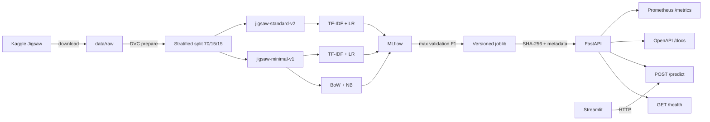
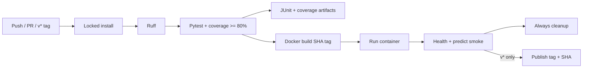

# Архитектура

## ML pipeline и inference

DVC фиксирует source, split, preprocessing manifests и реестр MLflow runs. Модель загружается один раз при lifespan startup API. До deserialization проверяются metadata, SHA-256 и model version. Sklearn Pipeline включает preprocessing, vectorizer и classifier, поэтому HTTP-слой не дублирует преобразования.

## CI

Jobs `image` и `publish` зависят от successful `quality`. GitHub token выдаётся CI и не хранится в репозитории. `concurrency` привязан к PR number или ref, что исключает дубли.
